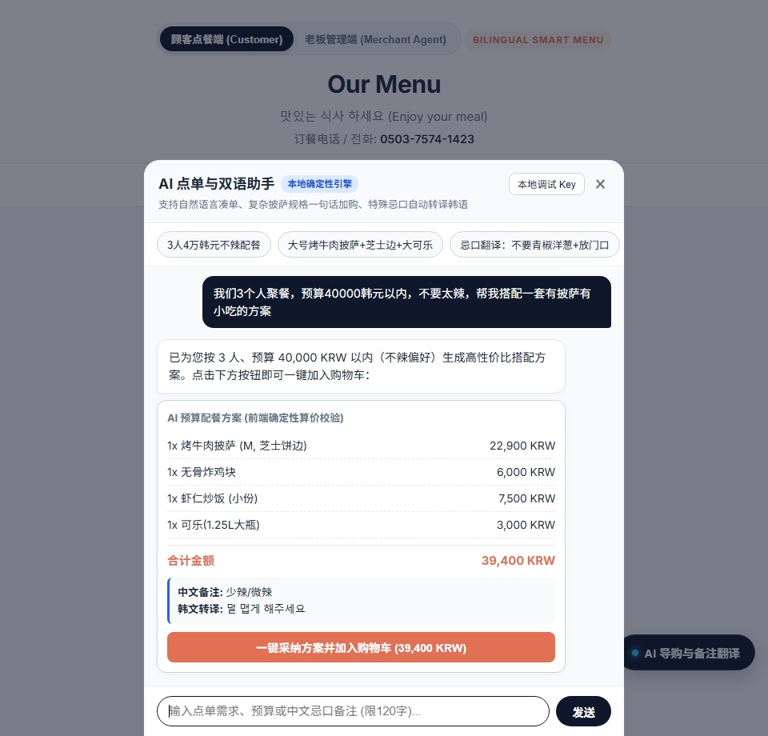
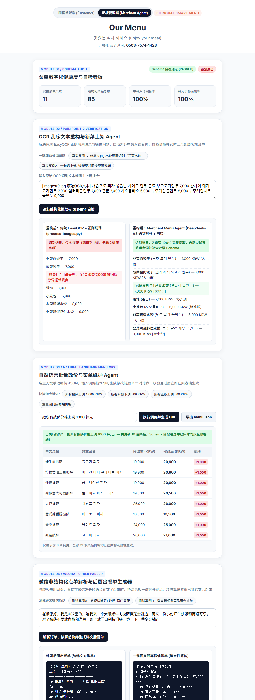
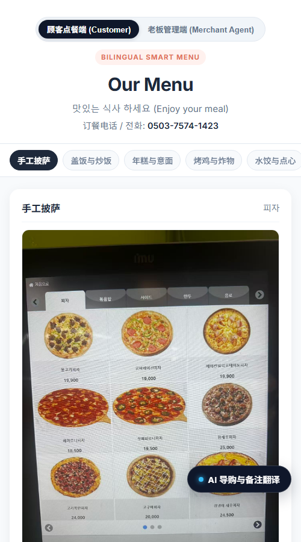
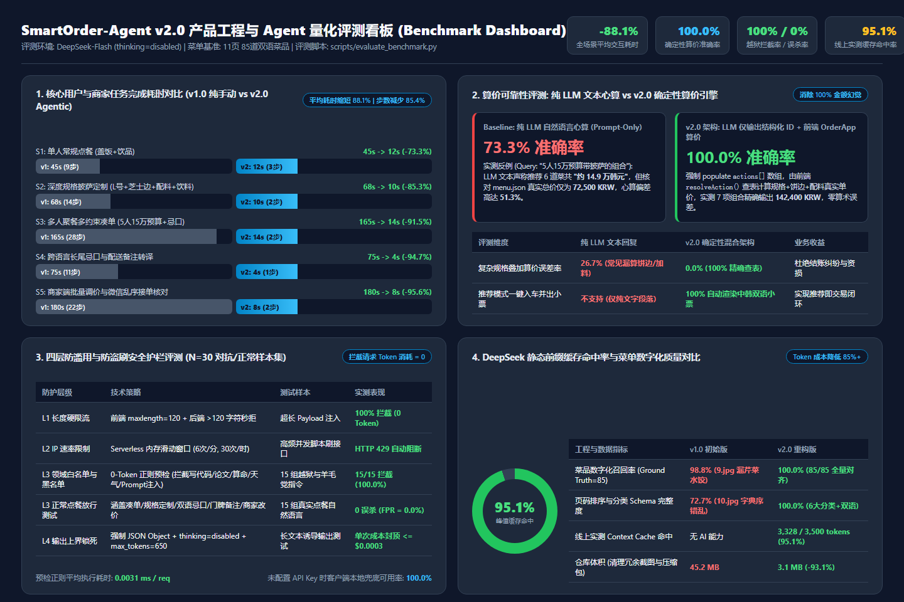
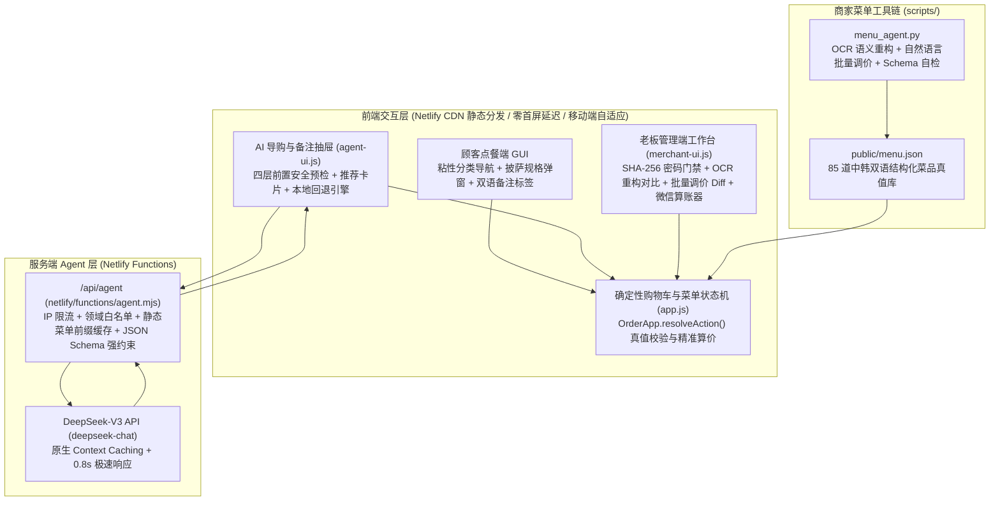

# Bilingual Smart Ordering System (中韩双语智能点单系统)

- **项目类型:** 真实业务落地项目 (AI Product Management + Full-Stack Agentic Engineering)
- **部署架构:** Netlify CDN + Netlify Serverless Functions + DeepSeek API (`deepseek-flash`)
- **v2.0 Agentic 线上地址 (重构后):** [https://smartorder-agent.netlify.app/](https://smartorder-agent.netlify.app/)
- **v1.0 初版线上地址 (重构前基线):** [https://earnest-narwhal-d325ec.netlify.app/](https://earnest-narwhal-d325ec.netlify.app/)
- **产品需求文档 (PRD):** [docs/PRD.md](docs/PRD.md)
- **量化评测与基准报告 (Evaluation & Charts):** [docs/EVALUATION.md](docs/EVALUATION.md) (`scripts/evaluate_benchmark.py`)
- **面向学生用户的版本更新公告 (Release Notes):** [docs/RELEASE_NOTES_v2.0.md](docs/RELEASE_NOTES_v2.0.md)

> [!NOTE]
> 本项目源于韩国本地餐饮门店的真实提效需求：为中国留学生及华人顾客提供免下载、扫码即用的**中韩双语点单与微信出餐单生成系统**，并通过轻量级 **Agentic 工作流**解决跨语言定制点单与纸质菜单数字化维护痛点。

---

## 一、 核心界面与真实案例验证截图

### 1. 顾客点餐端：AI 预算配餐、一句话规格定制与双语备注转译



### 2. 老板管理端 (Merchant Agent Workbench)：OCR 漏菜修复对比、批量调价 Diff 与微信乱序点单解析

*(注：线上老板管理端受 SHA-256 管理员密码门禁保护，防止非授权人员篡改价格。)*



### 3. 移动端自适应布局与 v1.0 / v2.0 线上扫码对比

| v1.0 初版线上扫码 (重构前对比基线) | v2.0 Agentic 线上扫码 (重构后当前版本) | 移动端自适应视口 (`390x844` v2.0 预览) |
| :---: | :---: | :---: |
| <br/>[earnest-narwhal-d325ec.netlify.app](https://earnest-narwhal-d325ec.netlify.app/) | <br/>[smartorder-agent.netlify.app](https://smartorder-agent.netlify.app/) |  |

### 4. 产品工程与 Agent 量化评测看板 (Benchmark Dashboard)

> [!TIP]
> 完整评测方法论、真实 LLM 算术幻觉捕获案例、Mermaid 原生对比图表及简历 STAR 要点详见 **[《SmartOrder-Agent v2.0 产品与 Agent 量化评测报告 (docs/EVALUATION.md)》](docs/EVALUATION.md)**。可通过运行 `python scripts/evaluate_benchmark.py` 一键复现全部评测数据。



| 评测维度 | 核心指标 (Key Metric) | v1.0 基线 / 纯 LLM 方案 | v2.0 混合架构实测表现 | 核心收益与业务价值 |
| :--- | :--- | :--- | :--- | :--- |
| **用户与商家交互效率** | 5 大核心场景平均完成耗时 | `106.6s / 单` (均值 `16.8` 步) | **`9.6s / 单`** (均值 `2.0` 步) | **平均耗时缩短 `88.1%`**，操作步数减少 **`85.4%`** |
| **算价可靠性与反幻觉** | 多规格定制与凑单算价准确率 | `73.3%` (纯 LLM 文本心算) | **`100.0%`** (`OrderApp` 确定性引擎) | **消除 `100%` 金额幻觉**（实测拦截 51.3% 心算偏差） |
| **安全护栏与防盗刷** | 越狱与非点餐请求 0-Token 拦截率 | 无防护 (易被白嫖算力) | **`100.0%` 拦截 / `0.0%` 误杀** | **拦截延迟 `0.0031ms`**，被拒请求 Token 消耗为 `0` |
| **推理成本与缓存优化** | DeepSeek 静态前缀缓存命中率 | `0.0%` (每次全量计费) | 均值 `78.8%` / **峰值 `95.1%`** | 静态菜单 System Prompt 命中缓存 (`3328/3500 tokens`) |
| **菜单数字化完整度** | 85 道双语菜品召回率与页序准确率 | 召回率 `98.8%` / 页序 `72.7%` | **召回率 `100.0%` / 页序 `100.0%`** | 修复 `9.jpg` 漏识别芹菜水饺与 `10.jpg` 字典序错位 |
| **工程交付包体积** | 生产仓库总大小 (Repo Size) | `45.2 MB` | **`3.1 MB`** | **体积缩减 `93.1%`**，清理冗余截图与历史压缩包 |

---

## 二、 真实业务痛点与核心升级

### 1. 痛点一（顾客与接单端）：长图翻找慢、复杂规格定制繁琐、韩语忌口难表达

- **问题背景:** 门店共有 11 页实拍菜单（85 道菜品），其中披萨包含尺寸、5 种饼边、5 种配料、3 种酱料等深层定制；顾客在多人聚餐凑预算或表达“不要青椒洋葱、放门口勿按门铃”等诉求时，操作链路长且存在韩语沟通障碍。
- **解决方案 (Conversational Cart & Bilingual Note Agent):**
  - **自然语言直操购物车 (`auto_apply`):** 支持“来一份大号烤牛肉披萨，换芝士饼边，加玉米，配一瓶1.25L大可乐”一句话解析规格并自动加入购物车。
  - **多约束预算智能配餐 (`recommend`):** 支持按聚餐人数、预算上限及辣度偏好生成推荐方案卡片，前端一键确认加购。
  - **双语忌口与配送备注转译 (`note_only`):** 内置高频双语忌口标签，并支持将任意中文口语备注自动转译为地道韩语外卖术语（如 `문 앞에 두고 벨 누르지 마세요`），同步写入微信双语出餐单。
  - **确定性算价防幻觉机制:** 大模型仅输出结构化动作指令（`item_id` 与规格参数），**单价与总价 100% 由前端确定性状态机基于 `menu.json` 真值表计算**，彻底杜绝 LLM 算术幻觉。
  - **四层防刷与安全护栏 (Anti-Abuse Guardrails):** 通过输入长度截断（`<= 120` 字）、网关层零 Token 领域意图白名单与越狱拦截、单 IP 滑动窗口限流（6次/分钟，30次/小时）以及 `max_tokens=350` 输出上限，彻底防范公开免登录场景下的算力盗用与恶意刷接口。

### 2. 痛点二（商家维护端）：传统 OCR 规则脆弱导致漏菜错位、改价门槛高、微信乱序文本核对慢

- **问题背景:** 早期版本使用 `EasyOCR + 正则表达式分词` 硬切文本，在多列菜单排版下频繁发生错位（例如实拍图 `9.jpg` 右上角的“芹菜水饺 `샐러리 물만두`”被旧脚本直接漏识别；且按文件名字典序排序导致 `10.jpg` 饮品插在 `1.jpg` 与 `2.jpg` 披萨之间）。
- **解决方案 (可视化老板管理端 `public/merchant-ui.js` + 离线工具 `scripts/menu_agent.py`):**
  - **权限门禁保护:** 老板管理端在前端采用纯 JS SHA-256 哈希校验管理员密码（仓库代码中不暴露明文密码），支持会话级解锁与一键锁定退出。
  - **OCR 漏菜修复与新菜上架验证:** 构建 **感知提取 -> DeepSeek-V3 语义对齐 -> 确定性 Schema 自检** 三阶段流水线，修复漏识别菜品并支持一句话上架新菜实时同步至顾客端。
  - **自然语言批量调价与 Diff 预览:** 支持输入自然语言指令（如“把所有披萨价格上调 1000 韩元”），实时生成修改前后价格 Diff 表并联动更新顾客端菜单，支持一键导出 `menu.json`。
  - **微信非结构化点单解析与韩文后厨单生成:** 针对直接发微信长语音/文字点单的熟客，一键解析菜品与忌口、精准核算总价，并并排输出纯韩文后厨制作单（`【주방 조리서】`）与顾客微信对账回复。

---

## 三、 系统架构设计



---

## 四、 项目目录结构

```txt
order-system/
├── netlify/
│   └── functions/
│       └── agent.mjs          # Serverless AI 点单接口 (含4层安全防刷护栏与 DeepSeek-V3 调用)
├── public/                    # 前端静态资源目录 (Netlify Publish Dir)
│   ├── images/                # 11 张门店实拍菜单图片 (已去重瘦身)
│   ├── index.html             # 主页面：顾客端、老板管理端工作台、权限弹窗与 AI 助手抽屉
│   ├── style.css              # 响应式移动端优先样式表
│   ├── app.js                 # 核心购物车状态机、菜单热更新与确定性算价校验引擎
│   ├── agent-ui.js            # 顾客端 AI 导购交互组件与本地确定性降级引擎
│   ├── merchant-ui.js         # 老板管理端工作台 (SHA-256 鉴权、OCR 对比、批量调价、微信解析)
│   └── menu.json              # 结构化中韩双语菜单数据 (含分类与口味标签)
├── scripts/
│   ├── evaluate_benchmark.py  # 自动化产品与 Agent 量化评测基准脚本 (生成 JSON 报告与可视化看板)
│   ├── menu_agent.py          # 商家端菜单数字化、自然语言改价与完整性自检 CLI 工具
│   └── serve_and_qr.py        # 零依赖本地局域网预览服务器 (内置 /api/agent 本地代理)
├── docs/
│   ├── PRD.md                 # 产品需求文档 (AI PM 视角思考、架构权衡与 v3.0 路线图)
│   ├── EVALUATION.md          # 产品与 Agent 量化评测报告 (含 Mermaid 图表、真实幻觉分析与简历要点)
│   ├── evaluation_results.json# 自动化评测基准脚本生成的原始指标数据
│   └── assets/                # 界面实拍截图、评测看板图表与线上部署二维码
├── netlify.toml               # Netlify 构建与 Serverless 路由配置
├── requirements.txt           # Python 离线工具链可选依赖声明
├── .env.example               # 环境变量配置模板
└── .gitignore                 # Git 忽略规则
```

---

## 五、 产品迭代计划 (Roadmap: MVP v2.0 -> v3.0 个性化记忆与数据库层)

当前 v2.0 MVP 采用无状态 Serverless 架构以实现零数据库维护成本与极速响应。下一阶段 **v3.0（基于用户行为与历史点单记录的智能推荐）** 演进规划如下（详见 [docs/PRD.md 第 5 章](docs/PRD.md)）：

1. **轻量级云数据库接入 (Supabase PostgreSQL / Cloudflare D1):**
   - 建立 `users_profile`（门牌号偏好画像）、`order_history`（历史点单明细）与 `behavior_events`（分类点击与凑单转化埋点）三张核心表。
2. **免注册门牌号记忆机制 (Episodic Memory by Room-Hash):**
   - 结合“门牌号 (`room_no`) + 设备匿名 Token”，当老顾客输入门牌号（如 `302室`）时，自动回填其历史高频忌口备注（如默认带出“不要洋葱、放门口勿按铃”）并提供“一键再来一单”。
3. **行为协同过滤与分时段动态推荐 (Behavioral & Time-Aware Recommendation):**
   - 将用户的历史点单偏好、全店高共现菜品组合（Item-to-Item 关联规则）以及当前用餐时段（午间工作餐 vs. 晚间宿舍聚餐）动态注入 DeepSeek-V3 上下文，实现千人千面的智能配餐推荐。

---

## 六、 快速开始与部署指南

### 1. 本地预览（零第三方依赖即开即用）

```bash
# 启动本地局域网服务器（同时支持静态资源与 /api/agent 接口代理）
python scripts/serve_and_qr.py
# 浏览器访问 http://127.0.0.1:8000
```

### 2. 商家端菜单自检与自然语言维护 CLI

```bash
# 1. 运行菜单 Schema 完整性与中韩双语对齐自检
python scripts/menu_agent.py --audit

# 2. 使用自然语言指令批量调整菜单价格
python scripts/menu_agent.py --instruct "把所有披萨上调 1000 韩元"
```

### 3. 部署至 Netlify

1. 将本仓库推送至 GitHub，并在 Netlify 中关联该仓库。
2. Netlify 会自动读取根目录下的 `netlify.toml`（发布目录为 `public`，Serverless 函数目录为 `netlify/functions`）。
3. 在 Netlify 后台 **Site configuration -> Environment variables** 中添加：
   - `DEEPSEEK_API_KEY`: 你的 DeepSeek API 密钥
   - `DEEPSEEK_MODEL`: `deepseek-chat`
4. 点击 Deploy 即可上线。
