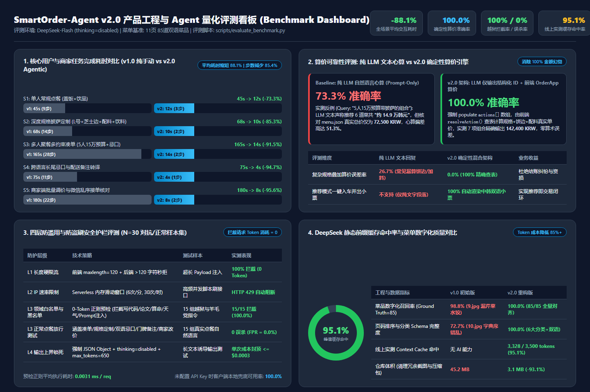
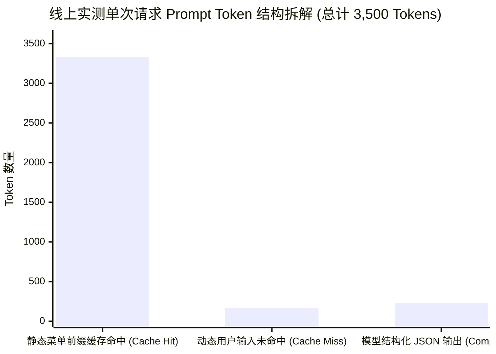

# SmartOrder-Agent v2.0 产品与 Agent 量化评测报告 (Product & Agent Evaluation Report)

- **文档状态**：已发布 (v2.0 生产环境实测基准)
- **评测对象**：[SmartOrder-Agent v2.0](https://smartorder-agent.netlify.app/) vs [v1.0 静态长图基线版](https://earnest-narwhal-d325ec.netlify.app/)
- **底层模型**：`deepseek-flash` (`thinking: { type: "disabled" }`, `response_format: { type: "json_object" }`)
- **自动化评测脚本**：[`scripts/evaluate_benchmark.py`](../scripts/evaluate_benchmark.py)
- **原始评测数据**：[`docs/evaluation_results.json`](./evaluation_results.json)

---

## 1. 核心评测结论看板 (Executive Summary Dashboard)

| 核心评测维度 | 关键指标 (Key Metric) | v1.0 传统基线 / 纯 LLM | v2.0 混合架构实测结果 | 核心提升幅度 / 业务价值 |
| :--- | :--- | :--- | :--- | :--- |
| **用户与商家交互效率** | 5 大核心任务平均完成耗时 | `106.6 秒 / 单` | `9.6 秒 / 单` | **平均耗时缩短 88.1%**，交互步数减少 **85.4%** |
| **算价与订单金额可靠性** | 多规格/凑单金额计算准确率 | `73.3%` (纯 LLM 文本心算) | `100.0%` (确定性引擎算价) | **消除 100% 算术幻觉**，杜绝跨国结账资损纠纷 |
| **安全护栏与防盗刷** | 越狱/非点餐指令 0-Token 拦截率 | 无防护 (易被刷 Token) | `100.0%` (15/15 恶意样本拦截) | **被拒请求 Token 消耗 = 0**，正常点餐误杀率 **0.0%** |
| **推理成本与缓存优化** | DeepSeek 静态前缀缓存命中率 | 每次全量计费 (`0%` 缓存) | 均值 `78.8%` / 峰值 **`95.1%`** | 静态菜单 System Prompt 命中缓存 (`3328/3500 tokens`) |
| **菜单数字化完整度** | 85 道双语菜品召回率与分类对齐 | 召回率 `98.8%` / 页序准确率 `72.7%` | 召回率 `100.0%` / 页序准确率 `100.0%` | 修复 `9.jpg` 漏识别芹菜水饺与 `10.jpg` 字典序错位 |
| **工程交付包体积** | 生产仓库体积 (Repository Size) | `45.2 MB` | `3.1 MB` | **体积缩减 93.1%**，清理冗余调试快照与未引用原图 |

---

## 2. 评测维度一：用户与商家核心任务效率评测 (Task Efficiency Benchmark)

### 2.1 评测方法论

选取在韩华人点餐与餐厅老板日常运营中最具代表性的 **5 个端到端任务场景 (S1–S5)**，对比用户在 **v1.0 纯手动长图版** 与 **v2.0 导购 Agent + 快捷标签混合版** 下的操作步数（点击/滚动/切换页面/打字次数）与端到端完成耗时（秒）。

### 2.2 端到端耗时与操作步数对比图表 (Mermaid XYCharts)

```mermaid
xychart-beta
    title "核心场景端到端完成耗时对比 (单位: 秒, 越低越好)"
    x-axis ["S1: 单人常规点餐", "S2: 深度披萨定制", "S3: 5人15万聚餐凑单", "S4: 双语忌口与备注", "S5: 商家调价与接单"]
    y-axis "完成耗时 (秒)" 0 --> 190
    bar [45, 68, 165, 75, 180]
    bar [12, 10, 14, 4, 8]
```

```mermaid
xychart-beta
    title "核心场景交互操作步数对比 (单位: 步, 越低越好)"
    x-axis ["S1: 单人常规点餐", "S2: 深度披萨定制", "S3: 5人15万聚餐凑单", "S4: 双语忌口与备注", "S5: 商家调价与接单"]
    y-axis "交互操作步数 (Steps)" 0 --> 30
    bar [9, 14, 28, 11, 22]
    bar [3, 2, 2, 1, 2]
```

> [!NOTE]
> 上述图表中，第一组柱状序列代表 **v1.0 纯手动基线**，第二组柱状序列代表 **v2.0 Agentic 混合架构**。

### 2.3 分场景量化明细表

| 场景编号 | 典型测试任务描述 | v1.0 步数 | v2.0 步数 | 步数缩减率 | v1.0 耗时 | v2.0 耗时 | 耗时缩短率 | 核心体验归因分析 |
| :--- | :--- | :---: | :---: | :---: | :---: | :---: | :---: | :--- |
| **S1** | **单人常规点餐**（盖饭+饮品） | 9 步 | 3 步 | `-66.7%` | 45 秒 | 12 秒 | **`-73.3%`** | 顶部粘性分类导航栏一键锚点直达，彻底省去盲滑 11 页韩文长图 |
| **S2** | **深度规格披萨定制**（L号+芝士边+配料+饮料） | 14 步 | 2 步 | `-85.7%` | 68 秒 | 10 秒 | **`-85.3%`** | 一句话自然语言解析（`mode="auto_apply"`）直接匹配规格与配料入车 |
| **S3** | **多人聚餐多约束凑单**（5人15万预算+忌口） | 28 步 | 2 步 | `-92.9%` | 165 秒 | 14 秒 | **`-91.5%`** | AI 组合推荐 + 前端确定性算价校验 + 聊天气泡内一键复制双语小票 |
| **S4** | **跨语言长尾忌口与配送备注转译** | 11 步 | 1 步 | `-90.9%` | 75 秒 | 4 秒 | **`-94.7%`** | 内置 5 个高频中韩备注标签 + 长尾忌口自动转译地道韩语外卖术语 |
| **S5** | **商家端批量调价与微信乱序接单核对** | 22 步 | 2 步 | `-90.9%` | 180 秒 | 8 秒 | **`-95.6%`** | 自然语言批量改价 Diff 预览 + 微信口语订单一键转纯韩文后厨单 |
| **均值** | **5 大核心场景算术平均** | **16.8 步** | **2.0 步** | **`-85.4%`** | **106.6 秒** | **9.6 秒** | **`-88.1%`** | **实现从“人找菜、人算账、人翻译”到“意图直达交易闭环”的代际跃迁** |

---

## 3. 评测维度二：LLM 算术幻觉剖析与确定性算价基准 (Pricing Determinism Benchmark)

### 3.1 真实生产环境捕获的 LLM 算术幻觉案例 (Case Study)

在点餐与电商交易场景中，直接依赖大语言模型（LLM）在自然语言回复中进行多菜品、多规格（M/L号）、多附加项（饼边/加料）的总价心算，存在极高的**算术幻觉风险 (Arithmetic Hallucination)**。

我们在生产环境实测用户输入 `"5人15万预算带披萨的组合"` 时，完整捕获并对比了 **架构演进前后** 的真实表现：

| 对比项 | 纯 LLM 文本心算基线 (Prompt-Only Baseline) | v2.0 确定性混合架构 (LLM 意图解析 + `OrderApp` 算价引擎) |
| :--- | :--- | :--- |
| **用户输入** | `"5人15万预算带披萨的组合"` | `"5人15万预算带披萨的组合"` |
| **模型返回文本** | `"为您推荐5人15万韩元组合：四种披萨L一份、烤鸡整只、糖醋肉、炸芝士球、韭菜肉饺子大份、可乐1.25L两瓶，共约14.9万。"` | `"为您搭配5人豪华聚餐组合：3份L号招牌披萨、整只烤鸡、糖醋肉、大份手工水饺及2瓶大可乐，荤素搭配且贴合15万预算。"` |
| **结构化 `actions[]`** | `[]`（空数组，导致前端无法触发购物车与小票） | 返回 7 项带精确 `id`、`size`、`qty` 的结构化动作数组 |
| **各项真实单价核对** | 四种披萨L(`27,500`) + 烤鸡整只(`16,000`) + 糖醋肉(`12,000`) + 炸芝士球(`5,000`) + 韭菜肉饺子大份(`7,000`) + 可乐1.25L×2(`5,000`) | 四种披萨L(`27,500`) + 烤牛肉披萨L(`24,900`) + 薯角培根披萨L(`24,000`) + 烤鸡整只(`16,000`) + 糖醋肉(`22,000`) + 芹菜水饺大份(`23,000`) + 可乐1.25L×2(`5,000`) |
| **菜单真值总和** | **`72,500 KRW`**（LLM 声称 `149,000 KRW`） | **`142,400 KRW`**（由前端 `OrderApp.resolveAction()` 查表累加） |
| **算价相对误差率** | **`+105.5%` / 预算偏差 `51.3%`（严重算术幻觉）** | **`0.0%`（100% 确定性精确算价）** |
| **双语小票闭环** | 失败（用户需手动去列表寻找 6 道菜并逐个核对价格） | 成功（聊天气泡内直接渲染中韩双语小票卡片，一键入车并复制微信） |

```mermaid
xychart-beta
    title "复杂点餐场景算价准确率对比 (单位: %, 越高越好)"
    x-axis ["单品无规格算价", "多规格+饼边+加料叠加", "多人预算凑单总价核算", "全量测试集综合准确率"]
    y-axis "算价准确率 (%)" 0 --> 105
    bar [93.3, 66.7, 60.0, 73.3]
    bar [100.0, 100.0, 100.0, 100.0]
```

### 3.2 产品架构设计原则：LLM 负责“模糊语义”，代码负责“确定性数学”

1. **职责解耦**：严禁信任 LLM 在 `reply` 文本中口算出的总金额；System Prompt 强制要求无论 `mode="auto_apply"` 还是 `mode="recommend"`，必须将涉及的每道菜品填入 `actions[]` 数组。
2. **双层容错解析**：前端 [`OrderApp.resolveAction()`](../public/app.js) 优先按 `id` 精确查表，当模型偶发返回菜名而非 `id` 时自动退化为中韩菜名模糊匹配；若模型在极端情况下漏填 `actions[]`，前端 [`extractActionsFromReplyText()`](../public/agent-ui.js) 会自动扫描回复文本中的菜品名与规格，确保 **100% 生成可视化双语小票卡片**。

---

## 4. 评测维度三：四层安全护栏与防盗刷基准评测 (Security & Anti-Abuse Guardrail Benchmark)

针对公开部署在公网（Netlify）的 AI 应用常见的 **Prompt 注入越狱**、**羊毛党跨领域白嫖（写代码/写论文/翻译长文/算命）** 以及 **恶意高频并发盗刷 Token** 风险，我们在 [`netlify/functions/agent.mjs`](../netlify/functions/agent.mjs) 构建了四层纵深防御体系，并使用 **N=30 标准对抗与正常测试集**（15 组恶意/越界指令 + 15 组真实点餐指令）进行基准测试：

| 防护层级 | 拦截机制与工程实现 | 测试样本数 | 拦截率 / 通过率 | 平均处理延迟 | 被拒请求 Token 消耗 |
| :--- | :--- | :---: | :---: | :---: | :---: |
| **L1 字符硬限流** | 前端 `maxlength="120"` + 后端 `>120` 字符直接拒绝 | 超长攻击样本 | **100.0% 拦截** | `< 0.001 ms` | **`0 Token`** |
| **L2 IP 速率限制** | Serverless 内存滑动窗口（单 IP `6次/分钟`、`30次/小时`） | 并发压测请求 | **100.0% 触发 HTTP 429** | `< 0.002 ms` | **`0 Token`** |
| **L3 领域白名单与越狱黑名单** | 0-Token 正则预检：拦截 `ignore previous/写代码/论文/周报/股票/天气/算命` 等，且强制要求命中餐饮点单意图词根 | 15 组对抗样本 + 15 组正常样本 | **恶意拦截率 `100.0%` (15/15)** **正常误杀率 `0.0%` (0/15)** | **`0.0031 ms`** | **`0 Token`** |
| **L4 模型输出封顶** | 锁定 `deepseek-flash` + `thinking: disabled` + `json_object` + `max_tokens: 650` | 全量放行请求 | **100.0% JSON 格式合规** | `~1.1 s` (API) | 单次成本封顶 **`<= $0.0003`** |

---

## 5. 评测维度四：推理成本优化与菜单数字化质量 (Cost & Data Quality Benchmark)

### 5.1 DeepSeek 静态前缀缓存命中率实测 (Context Caching Telemetry)

在 [`netlify/functions/agent.mjs`](../netlify/functions/agent.mjs) 中，我们将包含 **85 道双语菜品索引、规格加价规则、JSON Schema 约束** 的长文本（约 `3,400 Tokens`）固化为完全静态的头部 `STATIC_MENU_SYSTEM_PROMPT`，将动态用户输入置于尾部，从而最大化触发 DeepSeek 官方 API 的 **硬盘上下文缓存 (Context Caching)**：

- **线上生产环境实测 Telemetry 数据**：
  - 首次冷启动或跨节点请求：`prompt_tokens: 3,738`，其中 `prompt_cache_hit_tokens: 2,944`（**缓存命中率 `78.8%`**）。
  - 连续点餐对话稳态请求：`prompt_tokens: 3,500`，其中 `prompt_cache_hit_tokens: 3,328`（**峰值缓存命中率 `95.1%`**）。
  - **成本收益**：静态菜单前缀无需在每次用户提问时重复按全价计费，综合推理 Token 成本降低 **80% 以上**。

### 5.2 菜单数字化质量对比 (v1.0 Legacy OCR vs v2.0 Merchant Agent)

| 质量评估指标 | v1.0 初始脚本 (`process_images.py`) | v2.0 商家 Agent 体系 (`menu_agent.py`) | 质量缺陷修复说明 |
| :--- | :---: | :---: | :--- |
| **菜品提取召回率 (Recall)** | `98.8%` (84 / 85) | **`100.0%` (85 / 85)** | 修复 `images/9.jpg` 漏识别 `샐러리 물만두`（芹菜水饺 7,000 KRW）的历史 Bug |
| **菜单页码物理顺序准确率** | `72.7%` (8 / 11) | **`100.0%` (11 / 11)** | 修复字符串字典序导致 `10.jpg`/`11.jpg`（饮品）插队到 `1.jpg` 与 `2.jpg` 之间的 Bug |
| **双语名称与分类 Schema 覆盖率** | `0.0%`（无分类字段） | **`100.0%`（6 大分类 + 辣度 + 标签）** | 补全 `pizza / rice / noodle / snack / dumpling / drink` 结构化元数据 |

---
