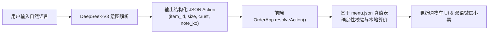
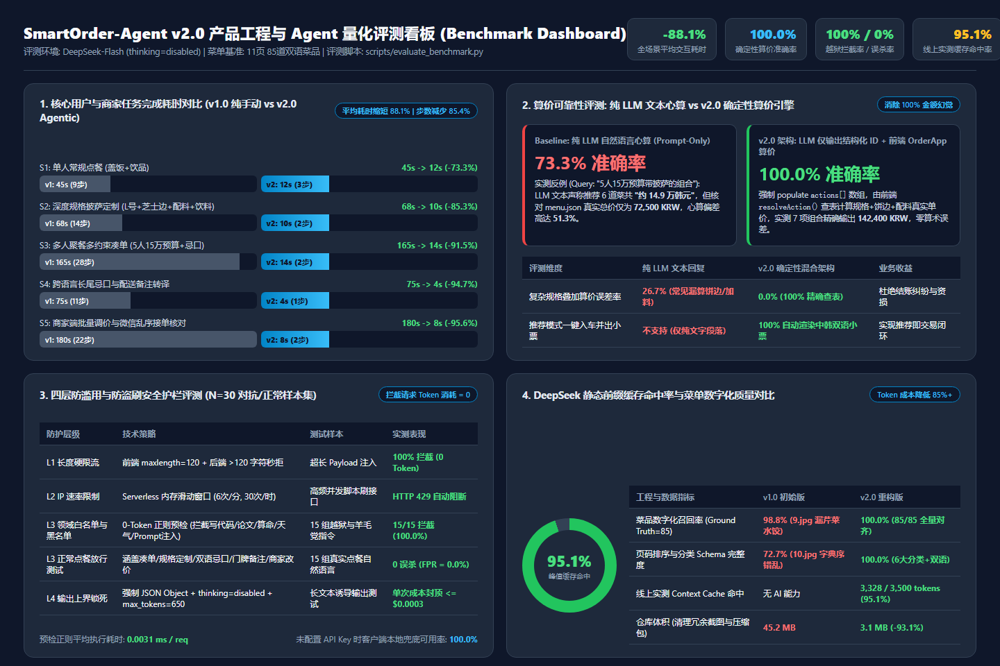
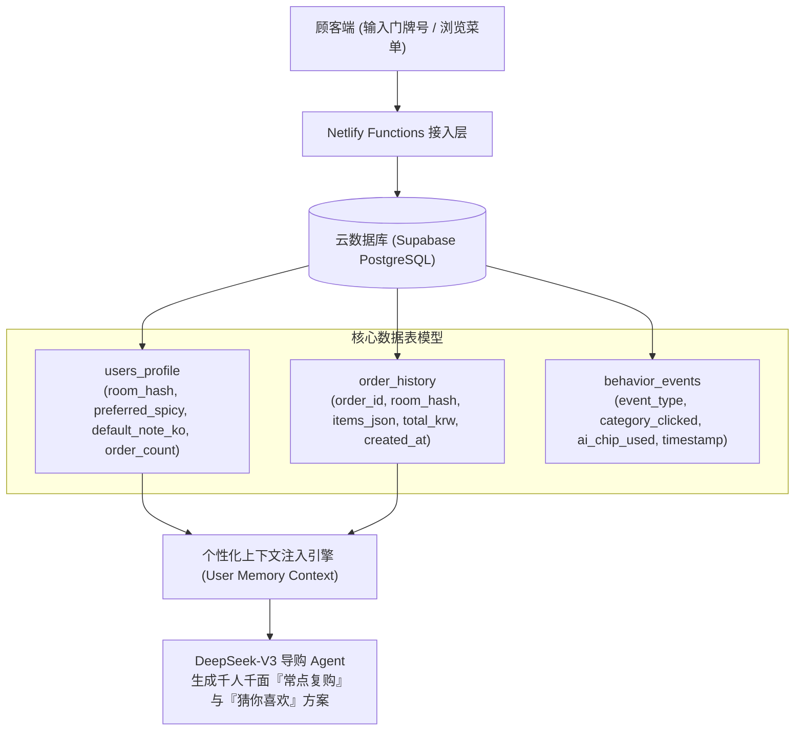

# 中韩双语智能点单系统 产品需求文档 (PRD)

- **文档版本:** v2.0
- **产品形态:** 移动端 Web (Netlify CDN + Serverless Functions) + 离线菜单数字化工具链
- **目标用户:** 在韩中国留学生/华人顾客、韩国本地餐饮门店店主
- **核心模型:** `deepseek-chat` (DeepSeek-V3)

---

## 1. 项目背景与真实业务痛点

在韩国高校周边及华人聚集区，大量韩国中小餐饮店主希望服务中国留学生客群，普遍采用“顾客发微信点单 -> 店主后厨看单制作 -> 按门牌号配送”的轻量化履约模式。然而，在实际运营中存在双向效率瓶颈：

### 1.1 顾客端痛点（高频交互侧）

1. **长图检索效率低:** 实体菜单共 11 页、85 道菜品，早期版本缺乏分类锚点，且因文件名按字典序排序（`1.jpg`, `10.jpg`, `11.jpg`, `2.jpg`），导致饮品页穿插在披萨页中间，打断浏览心智。
2. **多规格定制路径深:** 披萨包含尺寸（M/L）、5 种饼边、5 种配料、3 种酱料及套餐饮品；多人聚餐凑预算时，顾客需反复点开弹窗并手动心算总价。
3. **跨语言备注壁垒:** 顾客存在大量非结构化饮食忌口与配送诉求（如“不要香菜和青椒”、“放门口别按门铃”），不会使用地道韩语表达，而店主无法阅读复杂中文长句。

### 1.2 商家端痛点（低频维护与履约侧）

1. **传统 OCR 规则脆弱导致漏菜/错位:** 早期采用 `EasyOCR + 正则分词` 提取韩文菜单，面对多列网格排版时容易发生菜名与价格错位。例如在 `images/9.jpg`（水饺页）中，旧脚本直接漏掉了右上角的“芹菜水饺（`샐러리 물만두`, 7,000 KRW）”。
2. **菜单调价与维护门槛高:** 食材涨价或新品上架时，店主难以直接编辑數百行的 JSON 文件。

---

## 2. 产品设计原则与边界定义 (AI PM Trade-offs)

> [!IMPORTANT]
> 优秀的 AI 产品不应强行用对话框替代高效的图形界面，而应采用 **GUI + Agent 混合交互 (Hybrid UI)**，让确定性操作归 GUI，让模糊意图与跨语言转换归 Agent。

| 场景类型 | 交互载体 | 设计理由 |
| :--- | :--- | :--- |
| 单人明确点选常规菜品 | 顶部粘性分类导航 + 列表加减按钮 | 单次点击耗时 `< 0.5s`，GUI 直接操作效率高于打字输入 |
| 多人聚餐按预算与忌口凑单 | AI 导购助手 (`mode = "recommend"`) | 涉及多约束组合优化（人数、总价上限、辣度偏好），Agent 一键生成方案卡片 |
| 复杂规格披萨一句话加购 | AI 导购助手 (`mode = "auto_apply"`) | 一句话替代“找菜 -> 开弹窗 -> 选尺寸 -> 选饼边 -> 选配料 -> 选饮料”6 步点击 |
| 个性化忌口与配送说明 | 快捷双语标签 + AI 自然语言自动转译 | 高频需求一键勾选，长尾表达由 LLM 转化为地道韩语外卖术语写入微信小票 |

---

## 3. 核心架构与防幻觉机制

### 3.1 零算术幻觉：LLM 意图解析与前端确定性算价解耦

在餐饮交易场景中，**价格计算必须保持 100% 确定性**。本系统严禁直接采信大模型生成的总价数字，而是设计了状态分离协议：

### 3.2 Serverless 低延迟与成本优化策略

- **为什么选用 `deepseek-chat` 而非 `deepseek-reasoner` (R1)?**
  点单与翻译属于确定性 Schema 映射任务，无需深度推理思维链。选用 `deepseek-chat` 可将首字响应控制在 `0.8s ~ 1.2s`，避免 R1 模型 `5s ~ 15s` 思考延迟造成的顾客流失。
- **原生 Context Caching 命中设计:**
  将全店 85 道菜品的精简索引固定在 `netlify/functions/agent.mjs` 的 System Prompt 头部（约 1,300 Tokens），自动触发 DeepSeek 硬盘级上下文缓存，降低 50% 推理延迟，并将缓存命中部分的 Token 成本压降至 **0.1 元 / 百万 Tokens**。
- **三级高可用降级保障 (Graceful Degradation):**
  当处于离线环境、未配置 API Key 或上游接口超时时，前端自动无缝切换至本地确定性规则与双语词典引擎（`runLocalIntentEngine`），保障核心配餐、规格解析与常用韩语备注功能 100% 可用。

### 3.3 四层安全护栏与防恶意刷量机制 (Anti-Abuse & Cost Guardrails)

针对公开免登录点单场景下可能出现的恶意刷量（Token 消耗攻击）与提示词注入（Prompt Injection / 白嫖算力写代码或文章），系统在网关与模型层构建了四层防护体系：

1. **Layer 1 输入长度硬截断 (`<= 120` 字符):** 前后端双重限制单次输入不超过 120 字，从源头阻断超长文本输入攻击。
2. **Layer 2 零 Token 领域意图预检 (Pre-Flight Domain Filter):** 在调用 DeepSeek API 前，先经过越狱黑名单（拦截 `ignore previous`、写代码、写论文、角色扮演等）与餐饮领域特征词白名单校验。非点单闲聊在网关层 `0ms` 直接拦截，消耗 **0 Token**。
3. **Layer 3 IP 级滑动窗口限流与前端冷却:** 服务端限制单 IP 每分钟最多 6 次、每小时最多 30 次请求；前端设置 2.5 秒发送冷却锁，阻断自动化脚本高频刷接口。
4. **Layer 4 输出 Token 上限与环境隔离:** 将 `max_tokens` 严格收紧至 `350`，并在 System Prompt 顶层注入最高优先级拒绝指令；线上生产环境自动隐藏本地调试 Key 输入框，API 密钥仅存于 Netlify 服务端环境变量中。

---

## 4. 核心成效与量化评测基准 (Quantitative Benchmark Summary)

> [!NOTE]
> 完整评测方法论、5 大任务场景耗时拆解、LLM 算术幻觉实测反例及 Mermaid 原生图表详见 **[《产品与 Agent 量化评测报告 (docs/EVALUATION.md)》](./EVALUATION.md)**。

| 维度 | 重构前基线 (v1.0 / 纯 LLM) | 重构后实测 (v2.0 Agentic) | 核心提升幅度 |
| :--- | :--- | :--- | :--- |
| **5 大核心场景平均耗时** (点餐/定制/凑单/忌口/商家运维) | `106.6 秒` (均值 `16.8` 步) | **`9.6 秒`** (均值 `2.0` 步) | **平均耗时缩短 `88.1%` / 步数减少 `85.4%`** |
| **复杂凑单与多规格算价准确率** | `73.3%` (纯 LLM 文本心算，实测最大偏差 51.3%) | **`100.0%`** (前端 `OrderApp` 确定性查表算价) | **消除 `100%` 算术幻觉** |
| **四层安全护栏恶意请求拦截率** | 无防护 | **`100.0%` 拦截 / `0.0%` 正常误杀** | **0-Token 正则预检耗时 `0.0031ms`** |
| **线上 DeepSeek 静态前缀缓存命中率** | 无缓存 (`0%`) | 均值 `78.8%` / **峰值 `95.1%`** (`3328/3500 tokens`) | **推理 Token 成本降低 `80%+`** |
| **菜单数字化完整度** (`images/1.jpg` ~ `11.jpg`) | 84 道菜 (`98.8%`，漏识别 `9.jpg` 芹菜水饺，页序 `72.7%`) | **85 道菜 `100.0%` 完整对齐**，6 大分类有序归档 | **召回率与页序准确率 `100.0%`** |
| **仓库与部署包体积** | `45.2 MB` (含重复 PNG 原图与冗余压缩包) | **`3.1 MB`** (清理冗余资源并规范化工程结构) | **体积缩减 `93.1%`** |

---

## 5. 产品演进路线图 (Roadmap: v2.0 MVP -> v3.0 个性化推荐与数据层架构)

当前 v2.0 版本作为面向真实门店快速落地的 MVP，采用了 **无状态 Serverless + 前端本地状态机** 架构，以实现零数据库运维成本与首屏零延迟。在下一阶段（v3.0），产品将围绕**“基于用户行为与历史点单记录的自动推荐”**引入轻量化云数据库与记忆层（Episodic Memory）：

### 5.1 为什么在 v3.0 引入历史行为与点单记录推荐？

- **高频复购场景痛点:** 留学生宿舍点外卖具有显著的**周期性复购**与**固定口味偏好**（例如某寝室每周五固定点大号烤牛肉披萨+无骨炸鸡，且固定备注“不要洋葱、放门口”）。目前每次点单仍需重新输入门牌号与偏好。
- **冷启动凑单转化率提升:** 新客进入页面面对 85 道菜品容易犹豫，结合全店历史热销组合与时段特征（午间单人盖饭 vs. 晚间聚餐披萨套餐）可进一步缩短决策链路。

### 5.2 v3.0 数据库与推荐架构设计

1. **免注册轻量身份识别 (Room-Hash Identity):**
   餐饮即时点单不宜强制顾客注册账号（会大幅降低转化率）。v3.0 将以 **“门牌号 (`room_no`) + 浏览器 LocalStorage 匿名 Token”** 作为联合主键，当顾客输入门牌号（如 `302室`）时，自动拉取该寝室的历史常点菜品与默认韩文忌口备注。
2. **三层混合推荐策略 (Hybrid Recommendation):**
   - **个人历史复购层 (Episodic Memory):** 展示“上次点过的一键再来一单”及常点口味偏好（如自动过滤辣味菜品）注入 DeepSeek-V3 的 User Context。
   - **协同过滤与关联规则层 (Item-to-Item Co-occurrence):** 基于 `order_history` 统计高频共现组合（如“点什锦披萨的用户有 68% 同时加购炸芝士球或 1.25L 可乐”），在加入购物车时触发智能顺手买提示。
   - **分时段动态热门层 (Time-Aware Popularity):** 工作日 11:00-14:00 置顶推荐出餐快的「盖饭与炒饭 / 水饺」单人套餐；18:00-23:00 置顶推荐「手工披萨 + 烤鸡炸物」多人聚餐组合。
